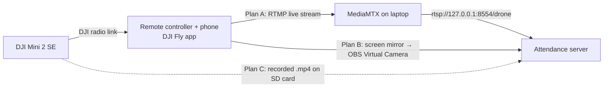

# Drone Integration Guide — DJI Mini 2 SE

This guide explains how to feed live video from a **DJI Mini 2 SE** into the Facial Attendance System, and what to do if a live link isn't possible.

---

## 1. How the system uses a drone

The attendance system is **camera-agnostic**. The Flask server opens whatever source is set in **Stream settings** (or the `DRONE_STREAM_URL` environment variable) with OpenCV, so any of these work as the "drone feed":

| Source type | Example value |
|---|---|
| RTSP stream | `rtsp://127.0.0.1:8554/drone` |
| RTMP / HTTP / UDP stream | `rtmp://…`, `http://192.168.1.5:8080/video` |
| Camera device index | `0`, `1`, `2` |
| Recorded video file | `C:\videos\class.mp4` |

Recognition runs on a single snapshot when you press **Scan & Mark Attendance**, so a few seconds of stream delay does not matter.

## 2. Why the Mini 2 SE can't be connected directly

- The Mini 2 SE sends video only to its remote controller and the phone running **DJI Fly**, over DJI's own radio link. A laptop can't receive that signal directly.
- DJI's developer kit (Mobile SDK) is **reported not to support the Mini 2 SE**, so we can't write our own app to pull frames from it or control it.

The video therefore has to be relayed out of the DJI Fly app. Three ways to do that are below; try them in order.



---

## 3. Plan A — Live stream through DJI Fly (recommended)

DJI Fly can push a live **RTMP** stream to a server. We run a small free relay, **MediaMTX**, on the laptop to receive it and re-serve it as RTSP for the attendance server.

> Check first: open DJI Fly → **Settings → Transmission** and confirm a **Live Streaming Platforms → RTMP** option is shown for your drone and app version.

### Steps

1. **Download MediaMTX** for Windows from <https://github.com/bluenviron/mediamtx/releases> (`mediamtx_…_windows_amd64.zip`). Extract it and run `mediamtx.exe`. Leave the window open.
   - It listens for RTMP on port **1935** and serves RTSP on port **8554**.
2. **Allow it through the firewall** by running this once in an Administrator PowerShell:
   ```powershell
   netsh advfirewall firewall add rule name="MediaMTX RTMP" dir=in action=allow protocol=TCP localport=1935
   ```
   Also make sure the Wi-Fi network is set to **Private** in Windows network settings.
3. **Put the phone and laptop on the same network.** Use the same Wi-Fi, or connect the laptop to the phone's hotspot.
4. **Find the laptop's IP address.** Run `ipconfig` and note the IPv4 address of the active adapter, e.g. `192.168.1.20`.
5. **Start the stream in DJI Fly.** Connect the drone, then go to **Settings → Transmission → Live Streaming Platforms → RTMP**. Enter:
   ```
   rtmp://192.168.1.20:1935/drone
   ```
   Choose **720p** and tap **Start**. 720p is enough because the face detector scales frames down to 800 px anyway, and it keeps latency low.
6. **(Optional) Test the relay** before opening the app: in VLC, use *Media → Open Network Stream* with `rtsp://127.0.0.1:8554/drone`.
7. **Point the attendance system at the relay.** Use either method:
   - **Web UI:** **Stream settings** → click the **Local relay** chip (`rtsp://127.0.0.1:8554/drone`) → **Save & Reconnect**.
   - **Environment variable** before starting the server:
     ```powershell
     $env:DRONE_STREAM_URL = "rtsp://127.0.0.1:8554/drone"
     python app.py
     ```
8. Select **Drone** in the top bar. The live feed and face tracking should appear.

---

## 4. Plan B — Screen-mirror bridge (if RTMP isn't available)

Mirror the DJI Fly screen to the laptop and expose it as a virtual webcam.

1. **Mirror the phone to the laptop.**
   - **Android:** install **scrcpy** (<https://github.com/Genymobile/scrcpy>), enable *Developer options → USB debugging* on the phone, connect by USB, and run `scrcpy`.
   - **iPhone:** use an AirPlay receiver app on the laptop (e.g. AirServer or LonelyScreen) and start *Screen Mirroring* from the phone.
2. **Open OBS Studio** (<https://obsproject.com>).
   - *Sources → + → Window Capture* → choose the mirror window.
   - Hold **Alt** and drag the edges to crop out DJI Fly's buttons and overlays, leaving only the camera image.
   - Click **Start Virtual Camera**.
3. **Connect it to the attendance system.** Either option works:
   - **Server-side (Drone source):** run `python tools/list_cameras.py`, find the index that belongs to *OBS Virtual Camera*, and enter that number in **Stream settings**. If the image is wrong, try the neighbouring indices.
   - **Browser-side (Webcam source):** select **Webcam** in the top bar, click the camera icon in the browser's address bar, and choose **OBS Virtual Camera**.

---

## 5. Plan C — Recorded footage / simulation (no drone needed)

Use this when no drone is available, or for demos with no network. A recorded video stands in for the drone. The server plays it as the drone feed, and every part of the pipeline runs on it exactly as it would in flight: live face tracking, **Scan & Mark Attendance**, Unknown labels and the attendance log.

### Recording the video

- **Drone footage:** fly and record. The Mini 2 SE saves the `.mp4` to its microSD card.
- **No drone:** record on a phone and imitate the drone. Stand **2–4 m** from the students, hold the phone at about face height, and pan slowly across the rows. Pause for a second or two on each group.
- **720p or 1080p MP4** works best. Keep the clip under a minute or two so it uploads quickly.

### Running the simulation

1. **Register the students first** (Register tab, webcam source), so the system has someone to recognise. Leave one or two people in the video unregistered to show the *Unknown* labels.
2. Open **Stream settings**. Under **"or simulate with a recorded video"**, choose the file and click **Upload & Play**.
3. The app switches to the **Drone** source and plays the video. The feed is labelled **Simulated drone feed**. Playback runs at the clip's real speed and **loops** when it ends.
4. Go to **Mark Attendance** and click **Scan & Mark Attendance** while faces are in view. Recognised students are marked present, and other faces are labelled *Unknown1*, *Unknown2*, …
5. Scan again at different points in the clip to pick up other rows. Students who are already marked show as *Already marked*.

You can also type the full path of a video file into **Stream settings** (e.g. `C:\videos\class.mp4`, with or without quotes) and click **Save & Reconnect**. Clicking **Save & Reconnect** again restarts the video from the beginning. Uploaded videos are kept in the `uploads/` folder, which git ignores.

### Network-camera simulation

To demonstrate the network-camera pipeline without the drone, install the **IP Webcam** app on an Android phone. Start its server and enter `http://<phone-ip>:8080/video` in **Stream settings**.

---

## 6. Flying for good recognition

- **Get close, at face level.** Hover about **2–4 m** in front of the students, roughly at eye height, facing them. Overhead shots only show the tops of heads and **will not be recognised**.
- **Frame a few rows at a time** instead of the whole room. Faces that look tiny on screen won't match.
- **Hold steady** for a second before pressing **Scan & Mark Attendance**. Ask students to look towards the drone.
- **Use good, even lighting.** Avoid strong backlight from windows.
- **Register students the same way you'll scan them.** Ideally capture each face from the drone feed at a similar distance and angle.

## 7. Safety and permissions

- The Mini 2 SE has **no obstacle-avoidance sensors**. Indoors, fly slowly, keep a safe distance from people, and fit **propeller guards**.
- Get **permission** from the institution and the people being filmed before flying or recording.
- Follow your local drone regulations, including the rules for flying near people.

## 8. Troubleshooting

| Problem | Fix |
|---|---|
| Feed shows *"Drone Camera Offline / Reconnecting…"* | The source can't be opened. Check that MediaMTX is running and DJI Fly shows it is live, then re-check the URL in Stream settings. |
| DJI Fly says it can't connect to the RTMP server | Phone and laptop are on different networks, the IP address is wrong, or the firewall is blocking port 1935 (see Plan A, step 2). |
| RTSP stream stutters or is grey/corrupted | Force RTSP over TCP: set `$env:OPENCV_FFMPEG_CAPTURE_OPTIONS = "rtsp_transport;tcp"` before `python app.py`. |
| Faces detected but shown as *Unknown* | Move closer and lower, improve the lighting, or re-register the student from the drone feed. |
| `list_cameras.py` doesn't show OBS | Make sure **Start Virtual Camera** is active in OBS, then run the script again. |
| Large delay in the live view | Normal for RTMP (a few seconds). Lower DJI Fly to 720p. Recognition uses a still frame, so delay doesn't affect accuracy. |

---

## 9. Summary for presentation

> The facial-recognition pipeline is complete and accepts any video source. The DJI Mini 2 SE has no developer SDK support, so instead of controlling the drone directly we take its video from the DJI Fly app: live through an RTMP stream relayed by MediaMTX (Plan A), through screen mirroring and an OBS virtual camera (Plan B), or from recorded footage (Plan C). In every case the attendance server receives normal video frames, detects every face, and marks recognised students present.

### References
- DJI Fly RTMP live streaming and supported models: <https://optiview.dolby.com/docs/millicast/capture/live-streaming-from-drones/>
- MediaMTX (RTMP/RTSP relay): <https://github.com/bluenviron/mediamtx>
- scrcpy (Android screen mirroring): <https://github.com/Genymobile/scrcpy>
- OBS Studio: <https://obsproject.com>
